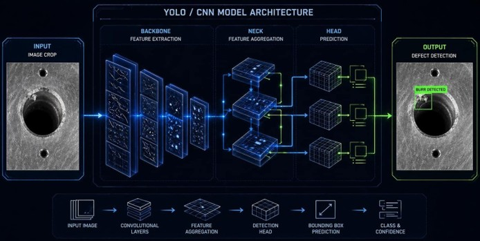
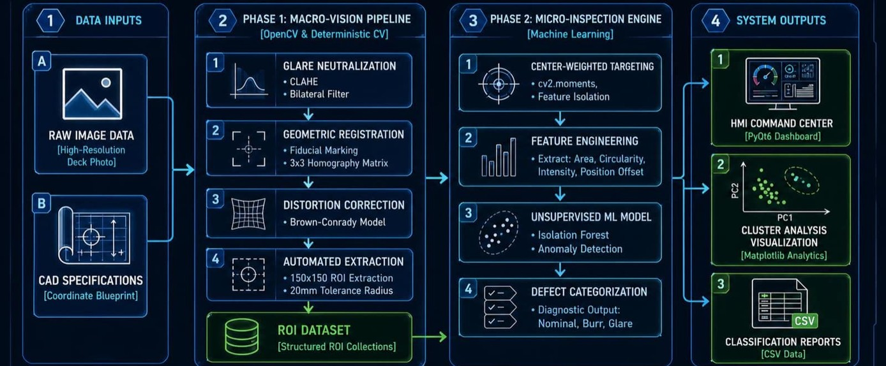
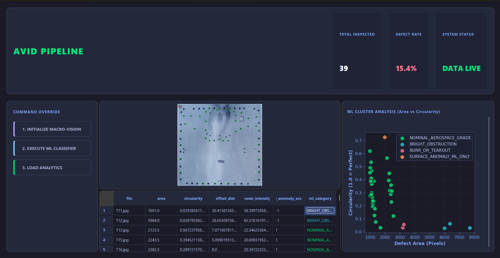
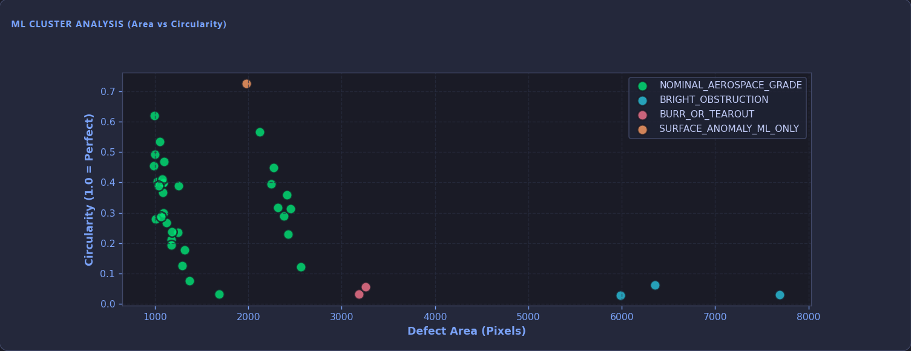

# 🛰️ AVID: Automated Vision & Inspection Pipeline for Aerospace Hardware

[](https://www.python.org/)
[](https://opencv.org/)
[](https://scikit-learn.org/)
[](https://pypi.org/project/PyQt6/)

**AVID** (Automated Vision Inspection for Decks) is a hybrid Machine Vision and Unsupervised Machine Learning pipeline engineered for sub-millimeter aerospace quality control. Developed during an internship at the **U R Rao Satellite Centre (URSC), ISRO**, AVID combines deterministic spatial transformation with robust anomaly detection to eliminate subjective manual inspection bottlenecks.

---

## 📋 1. Problem Statement & Engineering Challenges
Manufacturing high-reliability aerospace components under strict national standards requires zero-tolerance quality assurance. Manual inspection of metallic satellite decks is slow, error-prone, and highly subjective due to complex environmental and optical constraints:
* **Severe Surface Glare:** High-intensity factory lighting creates intense specular reflections across metallic surfaces, obscuring micro-feature boundaries.
* **Optical Distortion:** Wide-angle camera optics induce severe **16.5mm radial lens distortion** ("fish-eye" effect), warping outer-edge coordinates and shifting feature locations relative to CAD blueprints.
* **Data Scarcity & Cold Start:** Complete absence of pre-existing labeled defect datasets renders supervised deep learning architectures (like CNNs) impractical due to severe overfitting risks.

---

## 🧠 Engineering Evolution & System Architecture

### 1. Initial Approach: Supervised Deep Learning (YOLO / CNN Baseline)
Initially, we evaluated a standard object detection paradigm (**YOLO / CNN Architecture**) utilizing a Backbone (feature extraction), Neck (multi-scale feature aggregation), and Detection Head to localize bounding boxes and classify surface burrs directly from cropped regions.



**Why We Pivoted:**
* **Severe Data Starvation:** High-reliability aerospace manufacturing has virtually zero historical defect imagery, causing supervised CNNs to overfit rapidly.
* **Optical & Spatial Constraints:** Standard bounding-box detectors struggled with intense metallic specular glare and could not mathematically compensate for the **16.5mm radial lens distortion** required to verify sub-millimeter CAD coordinate tolerances.

---

### 2. Final Solution: Two-Phase AVID Hybrid Architecture
To overcome data scarcity and guarantee deterministic spatial precision, we engineered the **AVID Two-Phase Pipeline** combining classical Computer Vision with Unsupervised Anomaly Detection:



* **Phase 1 — Macro-Vision Pipeline (OpenCV):** Neutralizes metallic glare via **CLAHE & Bilateral Filtering**, aligns 2D CAD coordinates to physical imagery using a **$3\times3$ Homography matrix**, corrects lens distortion via the **Brown-Conrady model**, and extracts isolated $150\times150$ pixel ROIs within a 20mm tolerance radius.
* **Phase 2 — Micro-Inspection Engine (Scikit-Learn):** Applies center-weighted targeting (`cv2.moments`), extracts sub-pixel geometric features (Area, Circularity, Intensity, Offset), and trains an **Isolation Forest** model to flag structural burrs and glare obstructions without requiring labeled failure datasets.
* **System Outputs:** Feeds real-time telemetry into the multi-threaded **PyQt6 HMI Command Center**, interactive **Matplotlib cluster plots**, and structured **CSV classification reports**.

---

## 🏗️ 2. Architectural Approach
AVID abandons data-starved deep learning frameworks in favor of a bespoke, two-phase deterministic-stochastic pipeline optimized for speed, interpretability, and execution reliability in secure, air-gapped environments.

### Phase 1: Macro-Localization & Geometric Correction (OpenCV)
* **Illumination Normalization:** Applied *Contrast Limited Adaptive Histogram Equalization (CLAHE)* and *Bilateral Filtering* to neutralize metallic specular glare while preserving high-frequency structural edges.
* **Geometric Registration:** Computed $3 \times 3$ *Homography matrices* via RANSAC using 4 fiducial anchors, mapping 2D CAD blueprint spaces to physical photographs with zero reprojection error.
* **Distortion Compensation & ROI Extraction:** Dynamically expanded search radii to 20.0mm to capture outer holes displaced by radial distortion, automatically extracting isolated $150 \times 150$ pixel Regions of Interest (ROIs) across 43 micro-features while eliminating neighbor pixel bleed.

### Phase 2: Micro-Inspection & Unsupervised Learning (Scikit-Learn)
* **Sub-Pixel Feature Engineering:** Extracted quantitative geometric metrics strictly from target crops, including contour Area, Circularity, Mean Intensity (glare quantification), and spatial Position Offsets (Euclidean distance).
* **Unsupervised Anomaly Detection:** Deployed an **Isolation Forest** model to establish a mathematical baseline of "Nominal" aerospace-grade geometry from minimal training samples, effectively isolating structural outliers without requiring supervised labels.
* **Actionable Sub-Class Diagnostics:** Categorized anomalies into discrete physical defect classes:
  * 🟢 **NOMINAL_AEROSPACE_GRADE:** Optimal circularity and surface intensity metrics.
  * 🔵 **BRIGHT_OBSTRUCTION:** Intensity > 45 (features completely washed out by massive specular glare spikes).
  * 🔴 **BURR_OR_TEAROUT:** Circularity < 0.08 (physical metal warping, improper drilling, or edge tearouts).
  * 🟠 **SURFACE_ANOMALY_ML_ONLY:** Sub-pixel structural deviations flagged by the Isolation Forest.

---

## 🛠️ 3. Enterprise Software Solution & Deployment
To bridge the gap between machine learning models and factory floor operations, the system features a production-grade interface:
* **AVID Command Center:** A standalone, multi-threaded desktop application architected in **PyQt6**.
* **Thread Decoupling:** Heavy OpenCV computational pipelines and Scikit-Learn inference loops run on background worker threads, completely insulating the GUI thread from system freezing during execution.
* **Real-Time Telemetry:** Features embedded dynamic Matplotlib scatter plotting (Area vs. Circularity isolation clusters) and automated CSV telemetry logging (`ml_classification_report.csv`).

---

## 📊 4. Validation & Performance Metrics
During empirical validation runs on production-grade satellite hardware imagery, the pipeline achieved:
* **Operational Success:** Processed a validation batch of 39 complex micro-features with a **100% execution success rate**.
* **Defect Quantization:** Accurately computed a precise **15.4% defect rate**, successfully flagging structural burrs and optical obstructions.
* **Spatial Tracking:** Maintained reliable coordinate mapping with a mean positional offset tracking of 9.45 mm against baseline CAD tolerances.

### 🖥️ Visual Telemetry & Analytics Preview
| AVID Command Center GUI | Unsupervised ML Cluster Analysis |
| :---: | :---: |
|  |  |
| *Multi-threaded control panel with live KPI readouts and tabular inspection data.* | *Isolation Forest clustering separating nominal geometry from structural and optical anomalies.* |

---

## 📁 Repository Structure

```text
Satellite_deck_inspection/
├── AVID/
│   ├── core/                      # Computer vision sub-modules
│   │   ├── cad_parser.py          # Blueprint coordinate parser
│   │   ├── hole_detector.py       # Micro-feature inspection engine
│   │   ├── image_preprocessor.py  # CLAHE & Bilateral filtering
│   │   └── precision_inspector.py # Sub-pixel metric calculation
│   ├── homography.py              # Spatial transformation & RANSAC mapping
│   ├── ml_classifier.py           # Isolation Forest anomaly detection engine
│   └── pipeline.py                # End-to-end execution pipeline
├── assets/                        # Documentation images & UI previews
│   ├── avid_dashboard_preview.png
│   └── ml_cluster_analysis.png
├── models/                        # Serialized model weights & assets
├── reports/                       # Inspection telemetry and CSV outputs
│   └── real_run/                  
│       └── inspection_report.csv  # Sanitized execution report
├── avid_dashboard.py              # Main PyQt6 multi-threaded UI entry point
├── pixel_pick.py                  # Fiducial anchor calibration utility
├── requirements.txt               # System environment dependencies
└── README.md                      # Project technical documentation
```

---

